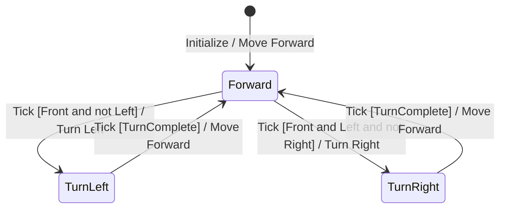

# Controller FSM Template

## Purpose
Represent the Controller process from
DFD Level 3 as a Finite State Machine.

## Inputs
- DFD Level 3 Controller inputs
- Control events and conditions
- Preliminary requirements

## FSM Notation
- State: Rounded rectangle in stateDiagram-v2.
- Initial State: [*]
- Transition: Directed arrow
- Transition Label: Event [Condition] / Action

## Mermaid Format

## Required Elements
1. Initial state
2. Controller states
3. Input events
4. Transition conditions
5. Output actions
6. State transitions

## Transition Description

Use the following format:

Event [Condition] / Action

For example:
Tick [Front and not Left] / Turn Left

## Transition Table

| Current State | Event | Condition | Action | Next State |
|---|---|---|---|---|
| Forward | Tick | Front and not Left | Turn Left | TurnLeft |

## Validation Rules
- All states must be defined.
- Every transition must have a valid source and target.
- All input events must originate from requirements or DFD.
- All output actions must match Controller outputs.
- Check for conflicting transition conditions.
- Check for missing transition conditions.
- Define priority when multiple conditions overlap.
- Identify unreachable states.
- Identify states with no valid outgoing transition.
- Do not invent unspecified transitions.

## Output
Save the FSM and Transition Table to:
artifacts/SA/DFD/dfd_level_4_fsm.md
