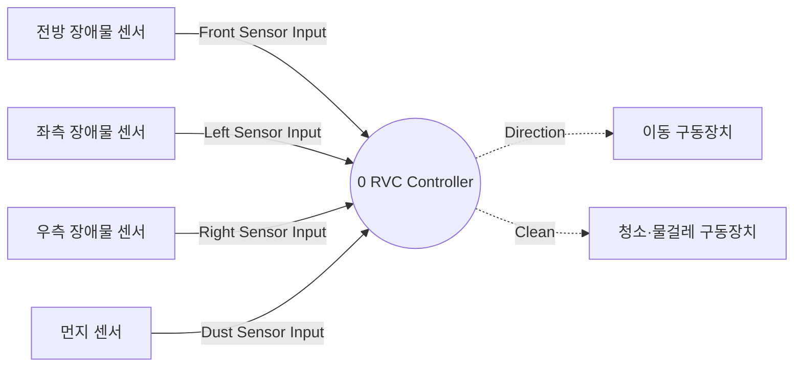

# DFD Level 0

상태: 검토용 초안. 요구사항의 TBD는 상세 동작 확정을 의미하지 않는다.

Context Diagram의 시스템을 Process 0으로 표시한다. 외부 엔티티와 흐름 이름·방향은 동일하다. Direction과 Clean은 제어 명령이므로 점선으로 세분 표기한다. 이는 Context Diagram의 명령 의미를 변경하지 않는다.

표기: 원은 데이터 처리, 점선 원은 제어 처리, 사각형은 해당 분해 경계의 외부 엔티티 또는 형제 프로세스이다. 실선은 데이터 흐름, 점선은 제어 명령 흐름이다. 영속 데이터 저장소는 요구되지 않아 추가하지 않았다. FSM의 동작 상태와 시간 경과는 제어 프로세스의 내부 기억이며 DB를 의미하지 않는다.

## Process 0 — 시스템 전체

관련 문서: [Data Dictionary](../data_dictionary.md), [Process Specifications](../process_specification.md), [요구사항 및 미정 사항](../event_list.md).
