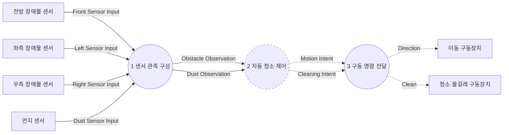

# DFD Level 1

상태: 검토용 초안. 요구사항의 TBD는 상세 동작 확정을 의미하지 않는다.

입력 관측, 상태를 가진 제어, 명령 전달의 세 기능으로 분해한다. 구동장치 피드백이나 외부 Tick은 추가하지 않는다.

표기: 원은 데이터 처리, 점선 원은 제어 처리, 사각형은 해당 분해 경계의 외부 엔티티 또는 형제 프로세스이다. 실선은 데이터 흐름, 점선은 제어 명령 흐름이다. 영속 데이터 저장소는 요구되지 않아 추가하지 않았다. FSM의 동작 상태와 시간 경과는 제어 프로세스의 내부 기억이며 DB를 의미하지 않는다.

## Process 0 분해

부모 0 경계 입력: Dust Sensor Input, Front Sensor Input, Left Sensor Input, Right Sensor Input.

부모 경계 출력: Clean, Direction. 이름·방향·상대 프로세스·흐름 종류를 그대로 보존한다.

관련 문서: [Data Dictionary](../data_dictionary.md), [Process Specifications](../process_specification.md), [요구사항 및 미정 사항](../event_list.md).
