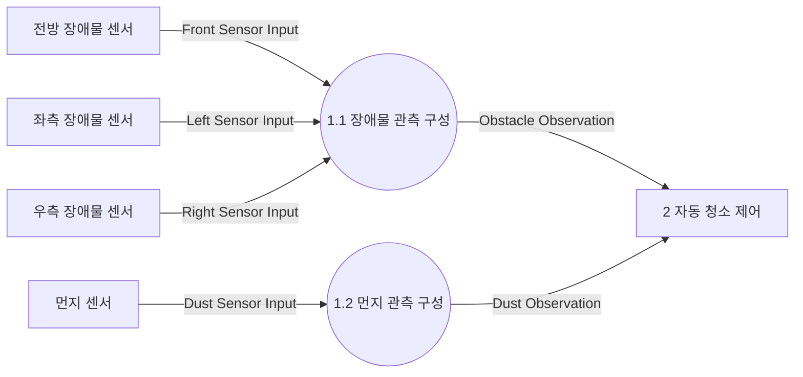
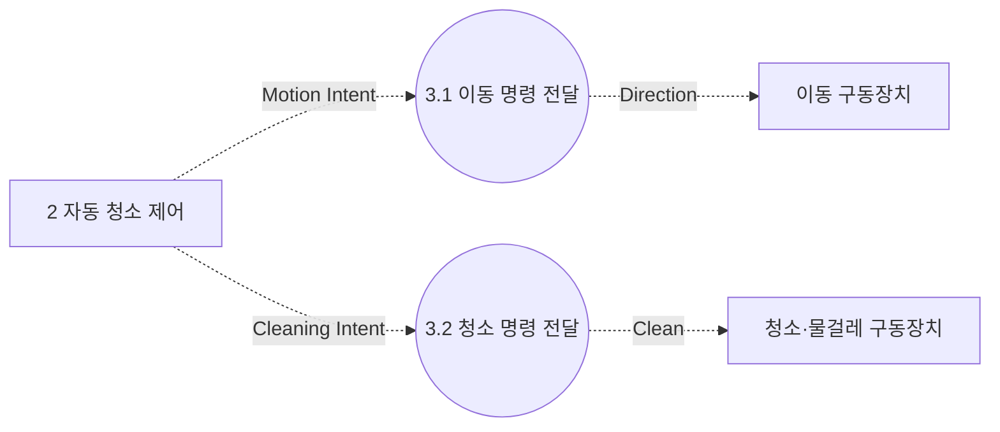

# DFD Level 2

상태: 검토용 초안. 요구사항의 TBD는 상세 동작 확정을 의미하지 않는다.

각 Level 1 프로세스를 별도 다이어그램으로 분해한다. 각 다이어그램에 나타나는 형제 프로세스는 해당 분해 경계의 외부 참조이며 새로운 시스템 외부 엔티티가 아니다.

표기: 원은 데이터 처리, 점선 원은 제어 처리, 사각형은 해당 분해 경계의 외부 엔티티 또는 형제 프로세스이다. 실선은 데이터 흐름, 점선은 제어 명령 흐름이다. 영속 데이터 저장소는 요구되지 않아 추가하지 않았다. FSM의 동작 상태와 시간 경과는 제어 프로세스의 내부 기억이며 DB를 의미하지 않는다.

## Process 1 분해

부모 1 경계 입력: Dust Sensor Input, Front Sensor Input, Left Sensor Input, Right Sensor Input.

부모 경계 출력: Dust Observation, Obstacle Observation. 이름·방향·상대 프로세스·흐름 종류를 그대로 보존한다.

## Process 2 분해

부모 2 경계 입력: Dust Observation, Obstacle Observation.

부모 경계 출력: Cleaning Intent, Motion Intent. 이름·방향·상대 프로세스·흐름 종류를 그대로 보존한다.

## Process 3 분해

부모 3 경계 입력: Cleaning Intent, Motion Intent.

부모 경계 출력: Clean, Direction. 이름·방향·상대 프로세스·흐름 종류를 그대로 보존한다.

관련 문서: [Data Dictionary](../data_dictionary.md), [Process Specifications](../process_specification.md), [요구사항 및 미정 사항](../event_list.md).
