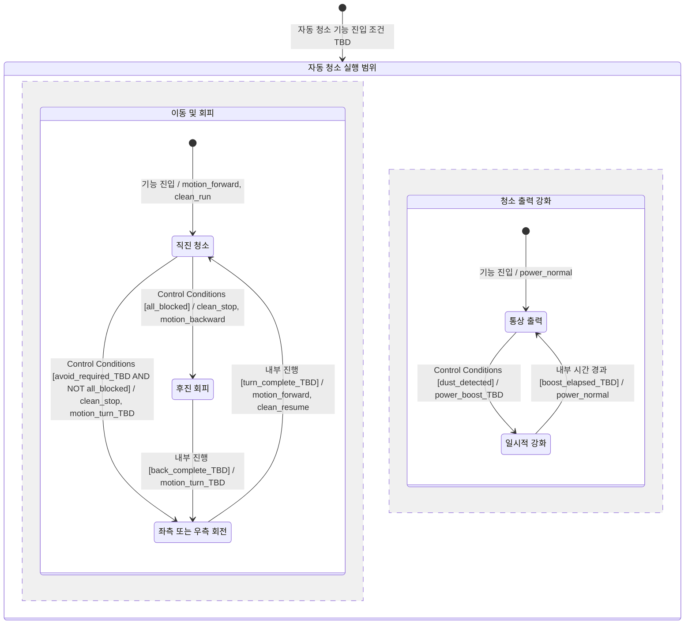

# DFD Level 4 — Controller FSM

상태: **요구사항 검토용 부분 FSM**. 대상은 [Level 3](dfd_level_3.md)의 **2.1.2 Controller**이다. 미정인 완료 조건과 충돌 정책이 있어 구현 가능한 완전한 FSM으로 승인된 상태가 아니다. Level 4에 대한 별도 Process Specification은 생성하지 않는다.

## 경계와 상태 의미

- 유일한 경계 입력은 `Control Conditions`, 출력은 `Control Decision`이다. 출력 내부 필드는 `Motion Intent`, `Cleaning Intent`이며 [Data Dictionary](../data_dictionary.md)를 따른다.
- 이동 상태와 일시적 출력 강화 상태를 직교 영역으로 표현한다. 이는 두 종류의 내부 기억을 구분하는 분석 표현이다. 회피 중 강화 유지·해제·일시정지 등 **동시 동작 정책을 확정하지 않는다**.
- FSM의 초기 진입은 이미 자동 청소 기능이 실행된 범위에서의 진입이다. 사용자 시작 명령이나 외부 시작 인터페이스를 추가한 것이 아니다. 실제 시작·종료 조건은 TBD이다.
- `내부 진행`은 외부 Tick이나 구동장치 완료 피드백을 뜻하지 않는다. 요구된 후진·회전·일시적 강화의 진행을 추상화한다. 완료 판정 수단·시간 단위는 TBD이다.
- `clean_stop`은 청소 중지 의도이며 이동 정지 명령이 아니다. `normal`은 일시적 강화가 아닌 청소 출력이며 구체 수치는 TBD이다. 물걸레의 회피 중 동작은 미정이다.

## FSM

출력 액션은 모두 `Control Decision`을 구성하기 위한 내부 필드 갱신이다. `motion_forward/backward/turn_TBD`는 `Motion Intent`, `clean_run/stop/resume` 및 `power_normal/boost_TBD`는 `Cleaning Intent`의 의미를 기술한다. `clean_run`에는 R1의 청소·물걸레 수행이 포함되지만, `clean_stop`과 `power_boost_TBD`가 물걸레에 미치는 영향은 정하지 않는다. 장치로의 출력은 2.2 및 3.1/3.2를 거친다.

## Transition Table

| Current State | Event | Condition | Action | Next State | 근거 / 미정 |
|---|---|---|---|---|---|
| 초기 | 자동 청소 기능 진입 | 시작 조건 TBD | 이동 영역과 강화 영역 진입 | AutomaticCleaning | R1, R7. 외부 시작 이벤트 아님 |
| Movement 초기 | 기능 진입 | 자동 청소 실행 범위 | motion_forward, clean_run | Forward | R1, R2 |
| Forward | Control Conditions | all_blocked | clean_stop, motion_backward | Backward | R3, R4 |
| Forward | Control Conditions | avoid_required_TBD AND NOT all_blocked | clean_stop, motion_turn_TBD | Turning | R3. 감지 조합별 회피 필요 판정·좌우 선택 TBD |
| Backward | 내부 진행 | back_complete_TBD | motion_turn_TBD | Turning | R4. 후진 종료·좌우 선택 TBD |
| Turning | 내부 진행 | turn_complete_TBD | motion_forward, clean_resume | Forward | R3, R4. 회전 종료 TBD |
| Power 초기 | 기능 진입 | 자동 청소 실행 범위 | power_normal | Normal | R5의 일시적 강화 전 기본 출력 구분; 수치 TBD |
| Normal | Control Conditions | dust_detected | power_boost_TBD | Boost | R5. 강화 정도·회피와의 충돌 정책 TBD |
| Boost | 내부 시간 경과 | boost_elapsed_TBD | power_normal | Normal | R5. 지속시간·경과 측정 방식 TBD |

## 조건 및 불완전성

| 항목 | 정의 또는 제한 |
|---|---|
| all_blocked | Control Conditions의 front AND left AND right. R4의 명시 조건 |
| avoid_required_TBD | R3의 “장애물 감지”를 감지 조합별 회피 필요 여부로 해석하는 규칙. 전방만인지 측면 단독 감지도 포함하는지 TBD |
| dust_detected | Control Conditions의 Dust Observation에서 먼지 감지 |
| back_complete_TBD | 후진 종료 조건과 판정 수단 TBD. 외부 피드백이나 센서 추가를 가정하지 않음 |
| turn_complete_TBD | 회전 종료 조건과 판정 수단 TBD |
| boost_elapsed_TBD | R5의 “for a while” 경과. 지속시간 및 시간 관리 방식 TBD |

- Forward의 두 회피 분기는 `all_blocked`와 `NOT all_blocked`로 겹치지 않는다. 이는 R4의 특별 조건을 구분한다.
- 정상적인 입력 변화가 없으면 현재 상태의 동작을 유지하는 추상 모델이다. 모든 미정 이벤트에 대한 자기 전이나 기본 동작을 임의로 추가하지 않았다.
- 이동 영역에서 회피와 강화 영역에서 먼지 감지가 동시에 발생하면 `clean_stop`과 `power_boost_TBD`의 합성 규칙이 필요하다. **우선순위는 정해지지 않았다.** 이 그림은 해당 충돌을 해결한 FSM이 아니다.
- 강화 중 먼지 재감지 시 연장·재시작 여부, 회피 동안 강화 시간의 진행 여부, 회전·후진 중 새로운 장애물 입력 처리도 미정이다.
- 조건이 충족된다는 전제에서는 Forward → Backward → Turning → Forward와 Normal → Boost → Normal의 도달 경로가 있다. 하지만 완료 조건이 미정이므로 실제 진행 가능성·교착 부재를 검증했다고 볼 수 없다.
- 종료 상태는 요구사항에 없어 추가하지 않았다. 시작·종료, 미정 가드, 동시 이벤트 및 물걸레 동작을 확인해야 FSM 완전성 검증과 SA 승인을 마칠 수 있다.
