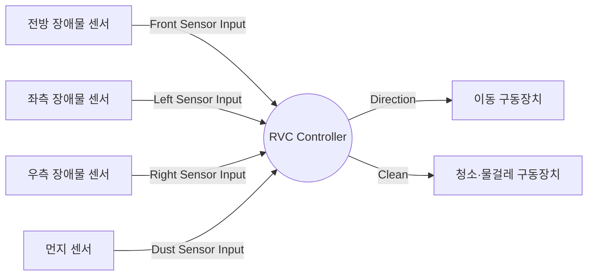

# RVC Controller System Context Diagram

## 범위

- 상태: 검토용 초안.
- 근거: [예비 요구사항](../../docs/preliminary_requirement.md), [Event List](event_list.md).
- 하나의 시스템 프로세스는 자동 청소 기능을 담당하는 RVC Controller 전체를 나타낸다.
- 사각형은 제어기 외부의 논리적 센서·구동장치 인터페이스를 나타낸다. 내부 프로세스나 하드웨어 상세 구현은 표현하지 않는다.

## Context Diagram

## 흐름 추적성

| Event List 흐름명 | 외부 엔티티 | 제어기 기준 방향 | 요구사항 |
|---|---|---|---|
| Front Sensor Input | 전방 장애물 센서 | 입력 | R3, R4 |
| Left Sensor Input | 좌측 장애물 센서 | 입력 | R3, R4 |
| Right Sensor Input | 우측 장애물 센서 | 입력 | R3, R4 |
| Dust Sensor Input | 먼지 센서 | 입력 | R5 |
| Direction | 이동 구동장치 | 출력 | R2, R3, R4 |
| Clean | 청소·물걸레 구동장치 | 출력 | R1, R2, R3, R5 |

`Clean`은 청소와 물걸레의 논리적 출력 묶음이다. 두 기능의 독립 제어 여부 및 회피 중 물걸레 동작은 미정이다. 이동 정지 명령·장치 피드백·사용자 입력 등 명시되지 않은 인터페이스는 추가하지 않았다. 요구사항 미정 사항은 [Event List](event_list.md)에 기록했다.
