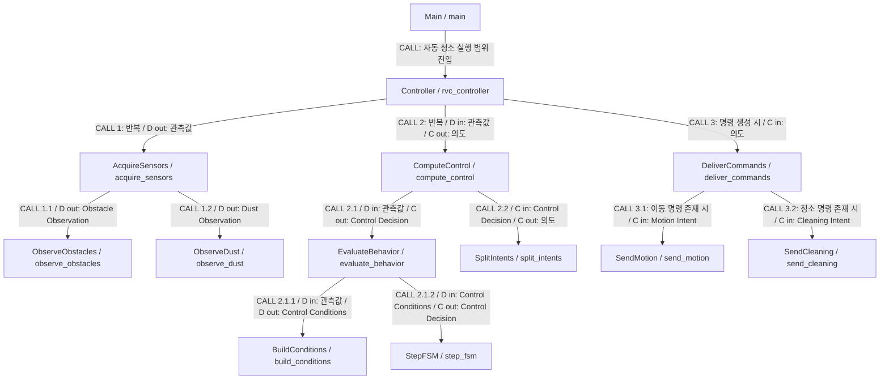
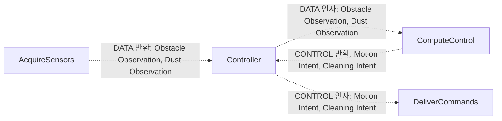

# RVC Controller Structure Chart

## 1. 목적과 상태

[Transform Analysis](transform_analysis.md)로 도출한 모듈의 호출 계층, 책임, 논리 인터페이스와 SA 추적성을 정의한다. **SD 검토용 초안**이며 SA의 Q1~Q7을 유지한다. 사용자 요청에 따라 현재 SA를 설계 기준으로 사용했으며, 확정되지 않은 동작을 승인된 정책으로 간주하지 않는다. TDD·구현 진행에는 별도 SD 승인이 필요하다.

## 2. 표기

- 사각형은 모듈이다. 실선 `CALL` 화살표는 호출자→피호출자의 실제 예정 함수 호출 관계이다.
- `D`는 관측·판단 자료인 Data, `C`는 의도·명령인 Control 정보이다. C는 C 언어 타입을 의미하지 않는다.
- `D out`/`C out`은 피호출자가 호출자에게 반환하는 정보이다. 호출 화살표의 방향과 반환값의 이동 방향은 다르다.
- 반복과 조건은 호출 라벨 및 실행 규칙에 명시한다. 모든 조건을 별도 함수나 모듈로 만들지는 않는다.
- Mermaid에서 데이터·제어 커플은 CALL 라벨의 `D`/`C`와 인터페이스 표로 구분한다. 별도의 정보 교환 그림에서는 점선 `DATA`와 `CONTROL` 라벨로 구분한다.

## 3. Module Hierarchy

호출 라벨의 번호는 한 호출 묶음에서의 논리적 순서를 나타내며 DFD 데이터 화살표를 복사한 것이 아니다. 관측값은 `{Obstacle Observation, Dust Observation}`, 의도는 `{Motion Intent, Cleaning Intent}`의 약칭이다. 장치가 호출자가 되는 관계나 입력→FSM 직접 호출은 없다.

### 호출을 통한 정보 교환 예

다음 그림은 위 CALL 계층의 일부에서 오가는 정보만 보인다. 추가 호출 관계가 아니다.

## 4. Module Descriptions

함수 이름은 향후 C11 구현에서 사용할 예정 식별자이다. 아래는 설계 명세이며 구현 코드·C 자료형 선언은 포함하지 않는다.

| Module | 예정 C 함수 | Responsibility | Called Modules | 상태 소유 |
|---|---|---|---|---|
| Main | main | 자동 청소 실행 범위에 진입하여 상위 제어기 호출 | Controller | 없음; 실제 시작·종료 조건 TBD |
| Controller | rvc_controller | 입력→판단→출력 호출을 조정하고 자동 청소 실행 범위에서 반복 | AcquireSensors, ComputeControl, DeliverCommands | 호출 묶음의 지역 관측·의도 |
| AcquireSensors | acquire_sensors | 두 관측값을 획득해 호출자에게 반환 | ObserveObstacles, ObserveDust | 반환값 구성용 지역 값 |
| ObserveObstacles | observe_obstacles | 세 방향 센서 입력을 수신해 Obstacle Observation 구성 | 없음 | 영속 상태 없음 |
| ObserveDust | observe_dust | 먼지 센서 입력을 수신해 Dust Observation 구성 | 없음 | 영속 상태 없음 |
| ComputeControl | compute_control | 동작 판단을 요청하고 결과를 두 의도로 분리 | EvaluateBehavior, SplitIntents | 지역 결정·의도 |
| EvaluateBehavior | evaluate_behavior | 조건 구성 후 FSM 판단 요청 | BuildConditions, StepFSM | 지역 조건·결정 |
| BuildConditions | build_conditions | 관측을 보존하고 all_blocked를 산출 | 없음 | 상태 없음 |
| StepFSM | step_fsm | FSM의 상태 전이를 평가하고 Control Decision 생성 | 없음 | 비공개 이동 상태·강화 상태·경과 정보 |
| SplitIntents | split_intents | 결정의 필드를 분리하여 두 의도 반환 | 없음 | 상태 없음 |
| DeliverCommands | deliver_commands | 생성된 의도를 해당 출력 모듈에 전달 | SendMotion, SendCleaning | 지역 인자만 사용 |
| SendMotion | send_motion | Motion Intent를 외부 Direction 출력으로 전달 | 없음 | 장치 정책 상태 없음 |
| SendCleaning | send_cleaning | Cleaning Intent를 외부 Clean 출력으로 전달 | 없음 | 장치 정책 상태 없음 |

기존 라이브러리 호출은 설계에 필요하지 않아 도입하지 않았다. `BuildConditions`와 `SplitIntents`는 상태 없는 보조 함수로 재사용 가능하지만 별도 라이브러리로 분리할 근거는 없다. 입력·출력 말단은 논리적 환경 경계이며, 이후 HW 어댑터가 필요하면 R6과 인터페이스 범위를 별도 검토한다.

## 5. Module Interfaces

각 행은 유일한 Caller→Callee 관계이다. 외부 환경 접근은 아래 별도 표로 구분한다. 데이터 이름은 [Data Dictionary](../SA/data_dictionary.md)를 따른다. 집합 표기는 논리 반환 묶음이며 C 구조체의 물리 레이아웃을 확정하지 않는다.

| Caller | Callee | Input Data (D) | Output Data (D) | Control Information (C) |
|---|---|---|---|---|
| Main | Controller | 없음 | 없음 | 자동 청소 실행 범위의 제어권 전달. 시작·종료 조건 TBD |
| Controller | AcquireSensors | 없음 | Obstacle Observation, Dust Observation | 없음 |
| Controller | ComputeControl | Obstacle Observation, Dust Observation | 없음 | 반환: Motion Intent, Cleaning Intent |
| Controller | DeliverCommands | 없음 | 없음 | 인자: Motion Intent, Cleaning Intent. 외부 출력 수행 |
| AcquireSensors | ObserveObstacles | 없음 | Obstacle Observation | 없음 |
| AcquireSensors | ObserveDust | 없음 | Dust Observation | 없음 |
| ComputeControl | EvaluateBehavior | Obstacle Observation, Dust Observation | 없음 | 반환: Control Decision |
| ComputeControl | SplitIntents | 없음 | 없음 | 인자: Control Decision. 반환: Motion Intent, Cleaning Intent |
| EvaluateBehavior | BuildConditions | Obstacle Observation, Dust Observation | Control Conditions | 없음 |
| EvaluateBehavior | StepFSM | Control Conditions | 없음 | 반환: Control Decision |
| DeliverCommands | SendMotion | 없음 | 없음 | 인자: Motion Intent. 외부 출력: Direction |
| DeliverCommands | SendCleaning | 없음 | 없음 | 인자: Cleaning Intent. 외부 출력: Clean |

### 외부 환경 경계

| Module | 외부 입력 | 외부 출력 | 외부 엔티티 |
|---|---|---|---|
| ObserveObstacles | Front Sensor Input, Left Sensor Input, Right Sensor Input | 없음 | 전방·좌측·우측 장애물 센서 |
| ObserveDust | Dust Sensor Input | 없음 | 먼지 센서 |
| SendMotion | 없음 | Direction | 이동 구동장치 |
| SendCleaning | 없음 | Clean | 청소·물걸레 구동장치 |

`Direction`과 `Clean`은 외부 부수효과이다. 장치 응답값을 반환한다고 가정하지 않는다. 비공개 FSM 상태는 `StepFSM`의 내부 기억이며 새 외부 데이터 흐름이 아니다. 내부 시간의 획득 방식은 TBD이고, 상위 인자에 외부 Tick을 추가하지 않는다.

## 6. SA-to-SD Traceability

| SA Process ID | SA Process Name | SD Module | Design Rationale |
|---|---|---|---|
| 0 | RVC Controller | Main, Controller | main 진입점과 전체 실행 조정으로 정제; 기능은 자식 호출을 통해 충족 |
| 1 | 센서 관측 구성 | AcquireSensors | 관측 획득 조정 |
| 1.1 | 장애물 관측 구성 | ObserveObstacles | 세 방향 감지 결과 구성 |
| 1.2 | 먼지 관측 구성 | ObserveDust | 먼지 감지 결과 구성 |
| 2 | 자동 청소 제어 | ComputeControl | 판단과 의도 분리를 조정 |
| 2.1 | 동작 판단 | EvaluateBehavior | 조건 구성과 FSM의 호출 순서 조정 |
| 2.1.1 | 제어 조건 구성 | BuildConditions | 상태 없는 조건 계산 |
| 2.1.2 | Controller | StepFSM | 상태와 시간 기억 은닉; SD Controller와 역할 구분 |
| 2.2 | 제어 의도 분리 | SplitIntents | 결정의 필드 분리 |
| 3 | 구동 명령 전달 | DeliverCommands | 출력 모듈 호출 조정 |
| 3.1 | 이동 명령 전달 | SendMotion | Direction의 논리적 외부 전달 |
| 3.2 | 청소 명령 전달 | SendCleaning | Clean의 논리적 외부 전달 |

R1 청소·물걸레와 R2 직진, R3 장애물 회피, R4 모두 막힘 후진, R5 일시적 강화는 `StepFSM`의 결정과 출력 경로로 이어진다. 구체 동작은 SA FSM 및 아래 제한을 따른다. R6은 입력·출력 경계를 논리 수준으로 제한하며, R7은 Controller 실행 범위를 제한한다.

## 7. 실행·조건·반복 규칙

1. `Main`은 자동 청소 기능 실행 범위에서 `Controller`를 호출한다. 시스템의 실제 시작·종료 사건은 Q7로 남긴다.
2. `Controller`는 관측 획득→제어 계산→생성된 명령 전달 순으로 호출을 반복한다. 반복 주기·동기화는 TBD이다. 이 순서는 한 판단에 관측값을 전달하기 위한 호출 순서이며, 물리적 센서 샘플링 순서를 요구하지 않는다.
3. `EvaluateBehavior`는 `BuildConditions`의 결과를 `StepFSM`에 전달한다. `all_blocked = front AND left AND right`를 유지한다.
4. `StepFSM`의 조건부 동작은 아래 표와 같다. 함수 분기를 수행하며 추가 호출 대상은 만들지 않는다. 반환 시에는 현재 판단의 `Control Decision`을 상위로 전달한다. 구체 갱신·재전송 정책은 TBD이다.
5. `SplitIntents`는 결정의 이동·청소 필드를 의미 변경 없이 분리한다.
6. `DeliverCommands`는 전달할 이동 명령이 있으면 `SendMotion`, 청소 명령이 있으면 `SendCleaning`을 호출한다. 판단 묶음에서 두 명령을 출력하는 경우 표의 논리 호출 순서를 사용하되, 장치의 동시성·원자성·명령 반복 억제 정책은 확정하지 않는다.

| FSM 조건 | 이동 의도 | 청소 의도 | 유지할 TBD |
|---|---|---|---|
| 자동 청소 범위 진입 및 정상 진행 | 직진 | 청소·물걸레 수행, 통상 출력 | 실제 진입 조건·출력값 |
| Forward에서 all_blocked | 후진 | 청소 중지 | 후진 종료·후방 처리·물걸레 동작 |
| Forward에서 avoid_required_TBD AND NOT all_blocked | 좌측 또는 우측 회전 | 청소 중지 | 회피 필요 판정·회전 선택 |
| Backward에서 back_complete_TBD | 좌측 또는 우측 회전 | 회피 중 상태 | 완료 판정·회전 선택 |
| Turning에서 turn_complete_TBD | 직진 | 청소 재개 | 회전 완료 판정 |
| Normal에서 먼지 감지 | 이동 영역이 결정 | 일시적 청소 강화 | 강화 정도·회피와의 합성 |
| Boost에서 boost_elapsed_TBD | 이동 영역이 결정 | 통상 출력 | 강화 지속시간·재감지 처리 |

청소 중지와 강화 요청의 동시 발생 우선순위는 정하지 않았다. 완료 조건이 미정인 상황을 임의로 “완료” 또는 “미완료”로 판정하는 기본 정책도 추가하지 않았다. 이 때문에 현재 설계의 동작 완전성·교착 부재는 검증할 수 없다.

## 8. Design Validation

- 전체 SA 프로세스를 위 추적성 표에 대응시키고 각 모듈에 호출자·피호출자·입출력을 정의했다.
- `StepFSM`만 지속되는 제어 상태를 소유한다. 상위 조정자는 지역 관측값과 결정값만 전달하며 다른 모듈의 내부 상태에 접근하지 않는다.
- 입력 구성과 출력 전달은 FSM 정책을 포함하지 않는다. 입력·판단·출력 모듈 사이의 직접 호출이나 공유 가변 전역 데이터가 필요하지 않은 구조이다.
- Q1~Q7 및 [부분 FSM의 제한](../SA/DFD/dfd_level_4_fsm.md)을 유지했다. 실제 실행 순서·출력 조합에 대한 완전한 동작 검증은 보류 상태이다.
- 실행한 문서 구조 검사의 결과와 범위는 [SD 검사 결과](validation_report.md)에 기록한다. 구현 코드는 생성하지 않았다.
