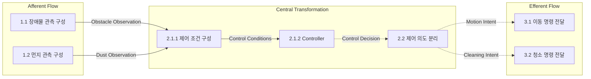

# RVC Controller Transform Analysis

## 1. 목적 및 설계 기준

DFD의 기능 분해를 입력 처리(Afferent Flow), 중앙 변환(Central Transformation), 출력 처리(Efferent Flow)로 분류하고 Structure Chart의 근거를 도출한다.

상태: **SD 검토용 초안**. 2026-11-06 사용자의 “transform analysis를 수행해서 structured chart를 만들어” 요청을 현재 SA를 바탕으로 SD 산출물을 작성하라는 진행 지시로 반영했다. 이 기록은 SA의 미정 요구사항을 확정하거나 구현 진행을 승인한다는 의미가 아니다. SA 문서의 기존 초안 상태를 변경하지 않았다.

설계 입력:

- [예비 요구사항](../../docs/preliminary_requirement.md), [Event List](../SA/event_list.md), [Context Diagram](../SA/context_diagram.md).
- [DFD Level 0](../SA/DFD/dfd_level_0.md), [Level 1](../SA/DFD/dfd_level_1.md), [Level 2](../SA/DFD/dfd_level_2.md), [Level 3](../SA/DFD/dfd_level_3.md), [Level 4 FSM](../SA/DFD/dfd_level_4_fsm.md).
- [Data Dictionary](../SA/data_dictionary.md), [Process Specifications](../SA/process_specification.md), [SA 검사 결과](../SA/validation_report.md).

요구사항 식별자 R1~R7과 미정 사항 Q1~Q7은 [SA 문서 목록](../SA/README.md)을 따른다. 분석은 HW 프로토콜·구동 알고리즘을 설계하지 않는 R6 및 자동 청소 기능으로 한정하는 R7을 유지한다.

## 2. Transform Regions

### Afferent Flow — 입력 관측 구성

| Process ID | Process Name | Input | Output | 분류 근거 |
|---|---|---|---|---|
| 1 | 센서 관측 구성 | Front Sensor Input, Left Sensor Input, Right Sensor Input, Dust Sensor Input | Obstacle Observation, Dust Observation | 외부 입력을 중앙 판단에서 사용할 논리 관측값으로 구성 |
| 1.1 | 장애물 관측 구성 | Front Sensor Input, Left Sensor Input, Right Sensor Input | Obstacle Observation | 세 방향의 감지 의미를 보존하여 묶음 구성 |
| 1.2 | 먼지 관측 구성 | Dust Sensor Input | Dust Observation | 감지 의미를 보존하여 전달 |

센서의 물리적 형식, 표본 동기화, 오류·필터 정책은 TBD이며 임의로 보강하지 않는다.

### Central Transformation — 동작 결정

| Process ID | Process Name | Input | Output | 분류 근거 |
|---|---|---|---|---|
| 2 | 자동 청소 제어 | Obstacle Observation, Dust Observation | Motion Intent, Cleaning Intent | 관측을 동작 의도로 변환하는 전체 책임 |
| 2.1 | 동작 판단 | Obstacle Observation, Dust Observation | Control Decision | 조건 구성과 상태 판단의 조정 |
| 2.1.1 | 제어 조건 구성 | Obstacle Observation, Dust Observation | Control Conditions | all_blocked 산출 등 도메인 판단 자료 구성 |
| 2.1.2 | Controller | Control Conditions | Control Decision | FSM 상태를 이용한 직진·회피·강화 결정 |
| 2.2 | 제어 의도 분리 | Control Decision | Motion Intent, Cleaning Intent | 제어 결정의 필드를 분리하여 중앙 변환의 의도 인터페이스 완성 |

2.1.1은 센서 데이터 수신이 아니라 논리 관측에 대한 제어 조건 구성이다. 따라서 중앙 변환의 앞부분으로 분류한다. 2.2는 장치 전달보다 앞선 결정 표현의 분리이므로 중앙 변환에 포함한다. 이는 설계상 분류이며 SA의 번호·의미·입출력을 변경하지 않는다.

### Efferent Flow — 구동 명령 전달

| Process ID | Process Name | Input | Output | 분류 근거 |
|---|---|---|---|---|
| 3 | 구동 명령 전달 | Motion Intent, Cleaning Intent | Direction, Clean | 동작 의도를 외부 장치 경계로 전달 |
| 3.1 | 이동 명령 전달 | Motion Intent | Direction | 이동 명령의 논리적 전달 |
| 3.2 | 청소 명령 전달 | Cleaning Intent | Clean | 청소·물걸레 명령의 논리적 전달 |

명령 전달 모듈은 회전 방향·강화 지속시간 등 동작 정책을 결정하지 않는다. 실제 장치 인코딩은 범위 밖이며 논리 출력 경계만 정의한다.

## 3. Transform Boundaries

| 경계 | 실제 DFD 연결 | 정보 종류 | 이유 |
|---|---|---|---|
| Afferent → Central | 1 → 2: Obstacle Observation, Dust Observation | Data | 센서 입력의 의미가 정리되어 동작 판단에 사용될 수 있는 지점 |
| Central → Efferent | 2 → 3: Motion Intent, Cleaning Intent | Control | 이동·청소의 의도가 결정되어 전달만 남은 지점 |
| 중앙 내부 상세 경계 | 2.1.1 → 2.1.2: Control Conditions | Data | 상태 없는 조건 구성과 상태를 보유한 FSM을 구분 |
| 중앙 내부 결정 경계 | 2.1.2 → 2.2: Control Decision | Control | FSM 결정과 정책 없는 필드 분리를 구분 |

상위 레벨 연결은 Level 2~3에서 동일한 경계 정보로 보존된다. 예를 들어 입력 경계의 관측값은 Level 3의 2.1.1에 도달한다. 외부 입력 4개와 출력 2개는 그대로 유지하며 새 인터페이스를 만들지 않는다.

## 4. Transform Analysis Diagram

아래 화살표는 **정보 흐름**이다. 함수 호출 계층은 [Structure Chart](structure_chart.md)에 별도로 제시한다. 실선은 데이터, 점선은 제어 정보를 나타낸다.

## 5. 제어 계층 도출

루트 `Main` 아래에 전체 호출을 조정하는 `Controller`를 배치한다. `Controller`가 `AcquireSensors`, `ComputeControl`, `DeliverCommands`를 순서대로 호출한다. 입력 모듈이 판단 모듈을 직접 호출하지 않으며, 관측 반환값을 상위 호출자가 다음 모듈에 전달한다.

`ComputeControl` 아래의 `EvaluateBehavior`는 `BuildConditions`와 `StepFSM`을 순서대로 호출하고, 결과를 `SplitIntents`로 분리한다. SA의 **2.1.2 Controller는 SD의 `StepFSM`**에 해당한다. SD의 `Controller`는 시스템 조정자이므로 두 이름을 같은 책임으로 해석하지 않는다.

자동 청소가 실행되는 동안 입력→판단→출력의 호출 묶음을 반복한다. 반복 주기, 센서 동기화, 내부 시간 관찰 수단과 시작·종료 조건은 Q7/Q4에 따라 TBD이다. 외부 Tick, 수치형 고정 주기, 별도 완료 신호를 도입하지 않는다.

## 6. 설계 제약 및 검토

- 정보 은닉: 이동 상태, 강화 상태, 내부 경과 정보는 `StepFSM` 모듈의 비공개 상태로 소유한다. 다른 모듈은 이 상태에 직접 접근하지 않는다.
- 응집도: 입력 구성, 조건 산출, 상태 전이, 필드 분리, 장치 전달 책임을 각각 구분한다.
- 결합도: 모듈 간에는 Dictionary의 명명된 값만 전달한다. 공유 가변 전역 데이터나 장치에서 FSM으로의 역참조를 설계하지 않는다.
- 상태 없는 보조 모듈은 독립적으로 호출 가능한 구조로 둔다. 재사용 라이브러리나 외부 라이브러리는 현재 요구사항에서 필요하지 않다.
- Q1~Q7은 설계에 그대로 이월한다. 특히 회피와 먼지 강화의 출력 합성 규칙 및 동작 완료 판정이 미정이므로 동작 정합성 전체를 확정할 수 없다.
- [구조 검사 결과](validation_report.md)는 문서 및 호출 계층의 정합성 검사이다. SD 승인 또는 실행 검증을 대체하지 않는다. TDD·구현은 SD에 대한 인간 승인 후 진행한다.
